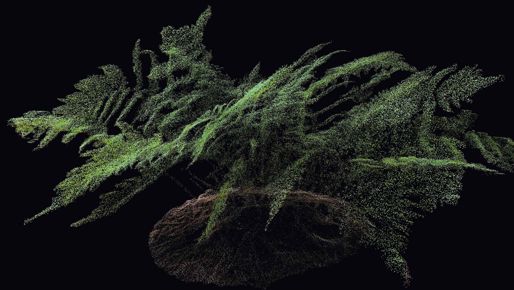

# Point Cloud Animation using rayLib and C++
*Click the image to watch the full animation on YouTube*

*Unfortunately Youtube compresses videos automatically, so it's less clear than watching a rendered mp4 :(*

## Project Overview

This is an animation I created for my piece *Focus Music: Pulses*. It certainly has some minimalist influence, from composers like John Adams and Steve Reich. My goal was to put the listener in a meditative state, so feel free to throw it on in the background while you scroll through this README :)

I've been wanted to create a point cloud animation for my music for a while now, and I finally got around to doing it. In the past, I've used Manim or JavaScript to create 2D animations using MIDI data, so creating a 3D animation with a focus on DSP rather than symbolic MIDI data was a great challenge. I ended up using C++ and programmed all the signal processing by hand. This turned out to be one of my favorite projects both technically and musically, I learned and grew so much.

Thanks to Louisiana State University for making the point cloud file public: 
https://xyz.cct.lsu.edu/dryopteris-erythrosora-01/

## Challenges I Overcame

 - Manim obviously was never designed to render 2 million particle animations, so I used C++ based rayLib instead
 - Instead of rendering the animation to a window and then screen recording with OBS, I sent the pixel information for each frame to FFmpeg and rendered it to an mp4
 - Programmed a naiveDFT to start, then worked my way up to a Radix-2 FFT

 ## Tech Stack

 - C++
 - CMake
 - RayLib
 - Dr_wav (library)
 - FastNoiseLite (library)
 - FFmpeg
 - Cloud Compare
 - MuseScore 4
 - Vienna Symphonic Library
 - Audacity 3 (for normalizing audio)